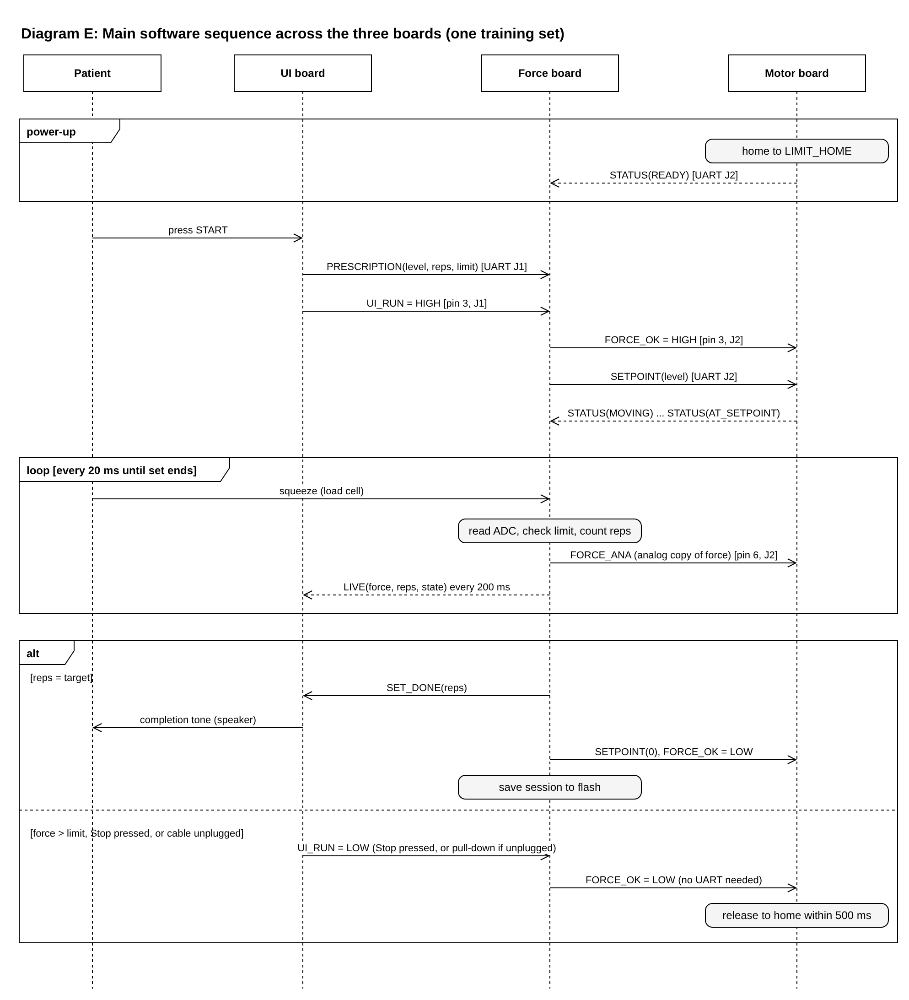
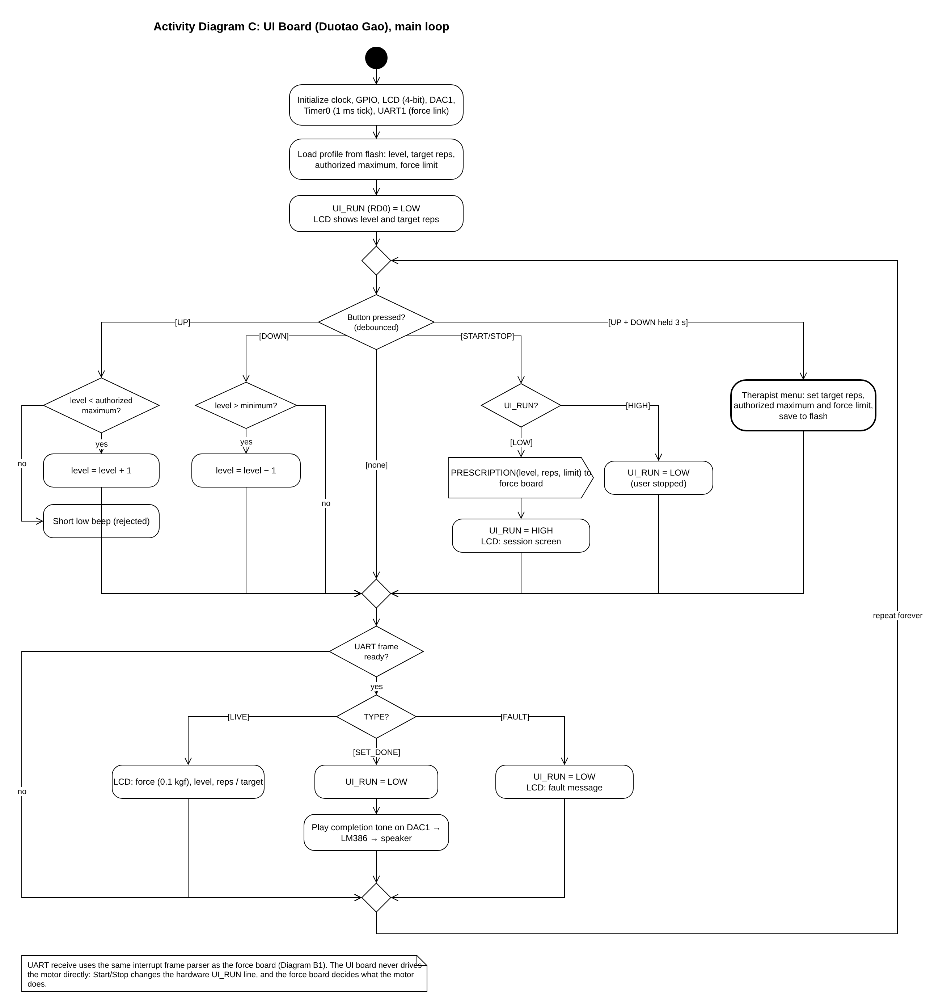
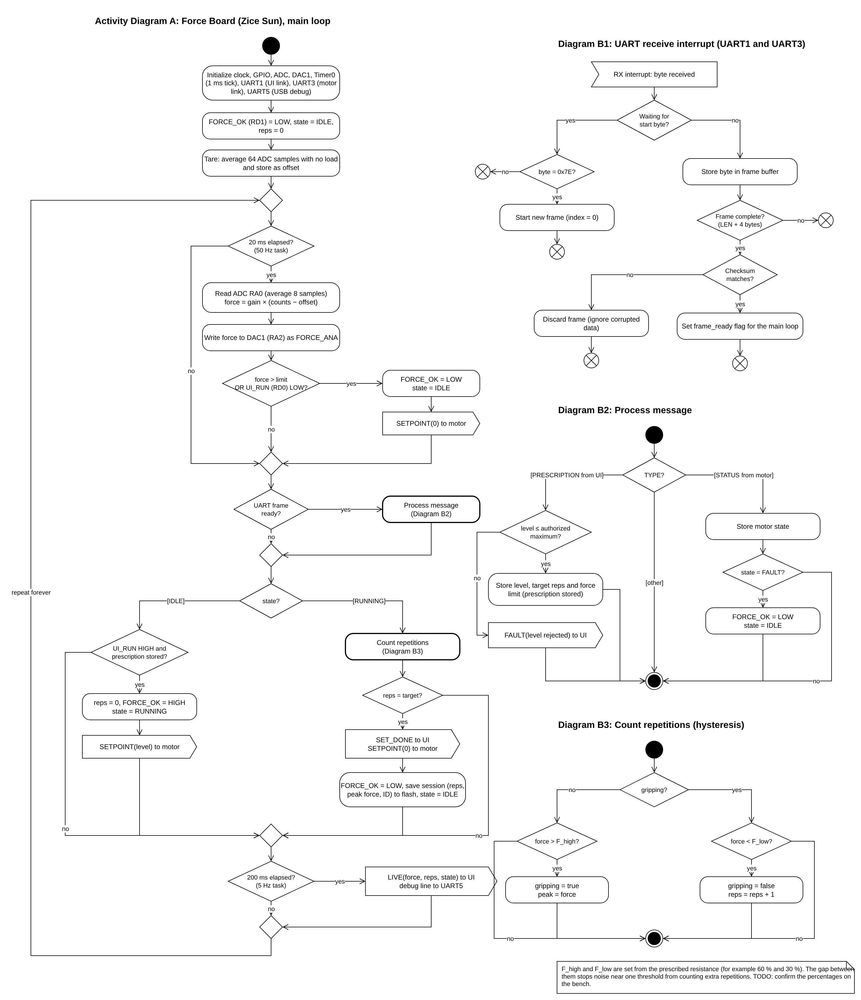
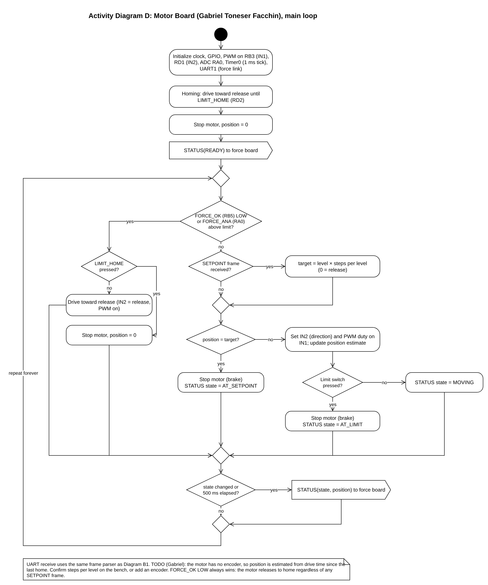

# Software Proposal

<!-- ============================================================
     HOW TO WORK ON THIS PAGE
     (HTML comments do not appear on the published page or in the PDF.)

     GRADING: 50 initial submission (Canvas: page URL + PDF of the live
     page, date in the Canvas calendar) + 150 at the External Design
     Review (quality) + 50 final report = 250.

     WHAT THE ASSIGNMENT GRADES
       - UML activity and/or state machine diagrams, ONE PER MICROCONTROLLER
         (FAQ: two MCUs -> two diagrams; we have three)          -> §4
       - Correct UML shapes, arrows connecting every box, labeled
         branches, no dead ends (the loop must run forever)       -> §3, §4
       - Granularity: user input broken into its steps           -> Diagram C
       - Communication protocol between devices documented        -> §5
       - NEW for the EDR: why the diagrams are structured this way
         and how the software meets the product requirements     -> §2, §6
       - PNG embedded on the page, .drawio source in the repo and
         linked; never link to a live draw.io / Google file        -> all

     OWNERSHIP
       Gabriel — presents this page at the EDR (2 min); owns Diagram D
                 (motor board) and the TODO in §7 about position
       Duotao  — owns Diagram C (UI board); checks the LCD fields and
                 button behavior match his schematic
       Zice    — owns Diagrams A and B1–B3 (force board), §5 message
                 structure, build, PDF export, Canvas submission
       Everyone — read §5 before writing any firmware: all three boards
                 must use the same frame format and type codes

     FILES (in docs/image/software/)
       software-proposal.drawio   one file, five diagrams on four pages
       sw-sequence.png, sw-ui-board.png, sw-force-board.png,
       sw-motor-board.png         PNG exports (2x, transparent)
       software-proposal-source.zip   drawio + PNGs, linked in §8
     To edit: open the .drawio in draw.io, change the page, then
     File > Export as > PNG (Zoom 200 %, Transparent background,
     Border 20) and overwrite the PNG with the same name.
     ============================================================ -->

## 1. Overview

GripRx uses three microcontrollers, one PIC18F57Q43 Curiosity Nano on each board. The UI board (Duotao Gao) reads the buttons, drives the LCD and plays sounds. The force board (Zice Sun) measures grip force, runs the training session and counts repetitions. The motor board (Gabriel Toneser Facchin) moves the spring preload to the requested resistance. This page documents how the firmware on each board behaves before any code is written: one sequence diagram for the whole system (Figure 1), one activity diagram for each microcontroller (Figures 2–4), and the message structure that all three boards share on the UART links (Section 5).

## 2. How We Structured the Software

<!-- NEW for the EDR: "Explain your decision making process for the
     structure of your software diagram". Keep it to the decisions. -->

**One diagram per microcontroller, plus one system view.** Each board runs its own program, so each one gets its own activity diagram, as the assignment asks. Because a reviewer cannot see from three separate loops how a training set actually flows between boards, we added a sequence diagram (Figure 1) that follows one set from the Start button to the completion tone.

**Activity diagrams instead of state machines.** All three programs are a "super-loop": a main loop that never ends and runs short tasks on fixed timers (50 Hz for force, 5 Hz for the display), while interrupts collect UART bytes in the background. An activity diagram shows that order of tasks and the decisions inside it more directly than a state chart. The force board does have two states (IDLE and RUNNING); we show them as one decision inside the loop rather than as a separate state machine, so the whole board fits on one page.

**Shared parts are drawn once.** The UART receive interrupt is the same on every board, so it is drawn once (Diagram B1) and referenced from the other two diagrams. Repetition counting and message handling are separate sub-diagrams (B2, B3) so the main loop stays readable.

**Safety does not depend on messages.** The two hardware lines on the ribbon cables, UI_RUN and FORCE_OK, are checked every loop. A UART message can be lost or corrupted; a pulled-down line cannot. Every diagram therefore checks the line first and treats a LOW line as "stop" no matter what message arrived.

## 3. Main Software Sequence

**Figure 1. Main software sequence across the three boards (one training set).**

At power-up the motor board drives the mechanism to its home limit switch, so it always starts from a known position, and reports READY. When the patient presses Start, the UI board sends the prescription (resistance level, target repetitions and force limit) to the force board and raises UI_RUN. The force board raises FORCE_OK and sends the resistance setpoint to the motor board, which moves the spring preload and reports its progress. During the set, the force board samples the load cell 50 times per second, checks the force limit, counts repetitions and sends live values to the display five times per second. A set ends in one of two ways: the target is reached, and the force board tells the UI board to play the completion tone and tells the motor board to release; or something unsafe happens (force over the limit, Stop pressed, or a cable unplugged), and FORCE_OK drops so the motor releases without waiting for any message.

## 4. Activity Diagrams

### 4.1 UI Board (Duotao Gao)

<!-- OWNER: Duotao. Check: button pins RD1–RD3, LCD fields, the
     therapist-menu button combination, tone on SET_DONE. -->

**Figure 2. Activity Diagram C: UI board.**

The UI board loads the patient's profile from flash at power-up and then loops forever. Each debounced button press has its own branch: Up and Down change the resistance level but never past the therapist's authorized maximum (a rejected press gives a short low beep), Start/Stop sends the prescription and raises UI_RUN or lowers it again, and holding Up and Down together opens the therapist menu where the target repetitions, maximum and force limit are set. Received frames update the LCD (LIVE), end the set with the completion tone (SET_DONE) or show a fault message (FAULT).

### 4.2 Force Board (Zice Sun)

<!-- OWNER: Zice. F_high / F_low percentages are a TODO for bench test. -->

**Figure 3. Activity Diagram A: force board, with sub-diagrams B1 (UART receive interrupt), B2 (process message) and B3 (count repetitions).**

The force board tares the load cell at power-up, then runs a 50 Hz task that reads the averaged ADC value, converts it to kilograms-force, copies it to the DAC as FORCE_ANA and checks the safety condition. If the force is over the limit or UI_RUN is LOW, it drops FORCE_OK and returns to IDLE immediately. In IDLE it waits for UI_RUN and a stored prescription before starting a set; in RUNNING it counts repetitions with two thresholds (B3) so that noise near one threshold cannot add extra counts. When the target is reached it ends the set and saves the repetition count, peak force and session number to flash. A 5 Hz task sends live values to the UI board and a debug line to the USB serial terminal.

### 4.3 Motor Board (Gabriel Toneser Facchin)

<!-- OWNER: Gabriel. Resolve the position TODO in §7 and check the
     pins against your final schematic (RB3 PWM, RD1 IN2, RD2/RD3
     limits, RB5 FORCE_OK, RA0 FORCE_ANA). -->

**Figure 4. Activity Diagram D: motor board.**

The motor board homes the mechanism at power-up and then loops forever. The first check in every loop is safety: if FORCE_OK is LOW, or FORCE_ANA shows a force above the limit, the motor drives toward the release end until the home switch is pressed, and any setpoint is ignored. Otherwise it converts the latest SETPOINT into a target position and drives the DRV8871 with direction on IN2 and PWM on IN1 until the target or a limit switch is reached. It reports its state to the force board whenever the state changes and at least every 500 ms.

## 5. Message Structure

<!-- OWNER: Zice. All three boards must match this table exactly. -->

### 5.1 Frame Format

Both UART links (J1 force–UI and J2 force–motor) run at 9600 baud, 8 data bits, no parity, 1 stop bit, and use the same frame:

**Table 1. UART frame format.**

| Byte | Field | Value |
|---|---|---|
| 0 | START | 0x7E |
| 1 | TYPE | Message type (Table 2) |
| 2 | LEN | Number of data bytes, 0–4 |
| 3 … 2+LEN | DATA | Message data, multi-byte values high byte first |
| 3+LEN | CHK | XOR of TYPE, LEN and all DATA bytes |

The receiver (Diagram B1) ignores bytes until it sees 0x7E, collects LEN + 4 bytes, and only accepts the frame if the checksum matches. A corrupted frame is dropped rather than acted on, and safety never depends on a frame arriving.

### 5.2 Message Types

**Table 2. Messages on the two UART links.**

| TYPE | Name | Direction | DATA | Sent when |
|---|---|---|---|---|
| 0x01 | PRESCRIPTION | UI → Force | level (1 B, kgf × 2), target reps (1 B), force limit (2 B, 0.1 kgf) | Start pressed |
| 0x81 | LIVE | Force → UI | force (2 B, 0.1 kgf), reps (1 B), state (1 B) | every 200 ms |
| 0x82 | SET_DONE | Force → UI | reps (1 B) | target reached |
| 0x83 | FAULT | Force → UI | code (1 B: 1 over-force, 2 motor fault, 3 level rejected) | on fault |
| 0x21 | SETPOINT | Force → Motor | level (1 B, kgf × 2; 0 = release) | set starts or ends |
| 0xA1 | STATUS | Motor → Force | state (1 B: 0 READY, 1 MOVING, 2 AT_SETPOINT, 3 AT_LIMIT, 4 FAULT), position (1 B) | state change, and every 500 ms |

The level byte stores the resistance in 0.5 kgf steps, so 2.0–30.0 kgf (CU-01) becomes 4–60.

### 5.3 Hardware Lines

**Table 3. Signals that are not UART messages.**

| Signal | Ribbon pin | Driven by | Meaning |
|---|---|---|---|
| UI_RUN | J1 pin 3 | UI board (RD0) | HIGH = session may run. 10 kΩ pull-down at the force board, so an unplugged cable reads "stop". |
| FORCE_OK | J2 pin 3 | Force board (RD1) | HIGH = motor may hold resistance. 10 kΩ pull-down at the motor board, so an unplugged cable reads "release". |
| FORCE_ANA | J2 pin 6 | Force board (DAC1, RA2) | Analog copy of the force, read by the motor board ADC (RA0) as a second over-force check. |

## 6. How the Software Meets the Product Requirements

<!-- NEW for the EDR. Cite the requirement IDs from the Product
     Requirements page; only claim what the diagrams actually do. -->

**Table 4. Product requirements and where the software meets them.**

| Requirement | How the software meets it | Where |
|---|---|---|
| SW-01 Resistance controlled toward the prescription | Force board sends the prescribed level as SETPOINT; motor board drives to it and reports AT_SETPOINT | Fig. 1, Diagram D |
| SW-02 / CU-02 Never above the authorized maximum | UI board refuses Up past the maximum; force board checks the level again before storing it and replies FAULT if it is too high | Diagrams C, B2 |
| SW-03 Session data kept without power | Repetition count, peak force and session number saved to flash when a set ends | Diagram A |
| SW-04 Automatic repetition counting | Two-threshold (hysteresis) counter on every 50 Hz force sample | Diagram B3 |
| SW-06 / MF-03 Force measurement and calibration | Tare at power-up, averaged ADC readings, gain and offset applied in firmware | Diagram A |
| UX-01 Start in three actions or fewer | Power on, (optionally adjust level), press Start | Diagram C |
| UX-02 / UX-03 Live force and counts on screen | LIVE frame every 200 ms (5 Hz) with force, reps and state | Diagrams A, C |
| UX-05 Notify when the target is reached | SET_DONE frame triggers the completion tone immediately | Fig. 1, Diagram C |
| SF-01 Release within 500 ms on over-force | Force checked every 20 ms; FORCE_OK drops in the same loop and the motor releases without a message; FORCE_ANA is a second check | Diagrams A, D |
| MF-01 Each subsystem testable alone | Every board runs from its own loop and prints to the USB terminal; a board can be tested with a computer in place of its neighbour | All |

## 7. Open Items

<!-- Update before the EDR: delete items that are resolved. -->

- **Motor position (Gabriel):** the gear motor has no encoder, so Diagram D estimates position from drive time since the last home. We will measure the time per level on the bench, and re-home at the start of every set to remove drift.
- **Repetition thresholds (Zice):** F_high and F_low are set as fractions of the prescribed resistance; the exact fractions will be chosen from bench data with the load cell.
- **Progression (CU-03, CU-05):** adjusting the next session from the last one is a "Should" requirement and is not in the first firmware version.

## 8. Source Files

The diagrams were drawn in draw.io. The editable source and the exported images are available as a [draw.io file](image/software/software-proposal.drawio) and as a [zip archive](image/software/software-proposal-source.zip).

---

## AI Use Disclosure

<!-- REQUIRED for EGR 304: full query disclosure. Add any further
     queries made for this page, and Duotao's and Gabriel's if they used
     AI, before export. -->

Generative AI (Claude) was used by Zice Sun to read the Software Proposal and External Design Review assignments, propose the structure of this page, draft the sequence diagram, the three activity diagrams and the message structure from the team's block diagram and pin assignments. The team reviewed the diagrams against each board's schematic and edited them before submission.

Full query text (Zice Sun, translated from Chinese):

1. Is the software proposal due before the presentation? None of our assignments has covered it yet, so how should we do it? Make a skeleton file.
